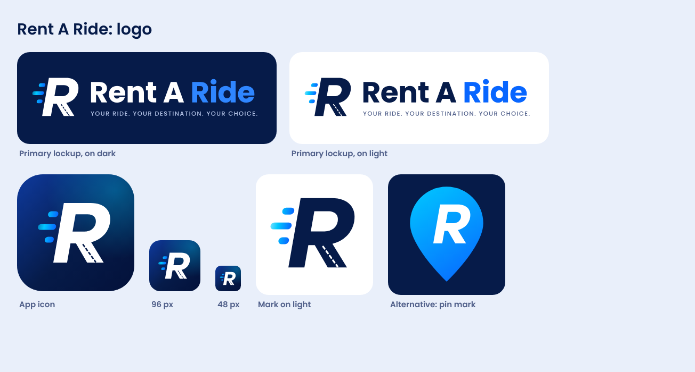

# Rent A Ride brand assets

| File | Use |
|------|-----|
| `rar_logo_horizontal_on_dark.svg` / `.png` | Primary lockup on navy or photos |
| `rar_logo_horizontal_on_light.svg` / `.png` | Primary lockup on white or light blue |
| `rar_mark_white.svg`, `rar_mark_navy.svg` | The "R" mark alone (avatars, small spaces) |
| `rar_app_icon.svg` | App icon with rounded corners (store listings, marketing) |
| `rar_app_icon_square.svg` | Full-bleed icon source; the OS applies its own mask |
| `rar_adaptive_foreground.svg` | Android adaptive-icon foreground (66 % safe zone) |
| `concept_pin_mark.svg` | Alternative concept: location pin with R |

All SVGs are pure vector. The wordmark text is converted to outlines, so it
renders without the Poppins font installed. `png/` contains 1024 px exports.

**Regenerate:** `python3 brand/tools/build_logo.py` (needs `pip install fonttools`),
then in `apps/passenger_app`: `dart run flutter_launcher_icons`.

The in-app `RarLogo` widget (`packages/rar_design_system`) draws the same
geometry in code.

Clear space: keep at least the height of one speed stripe clear around the
logo. Minimum size: 24 px for the mark, 120 px wide for the lockup.
